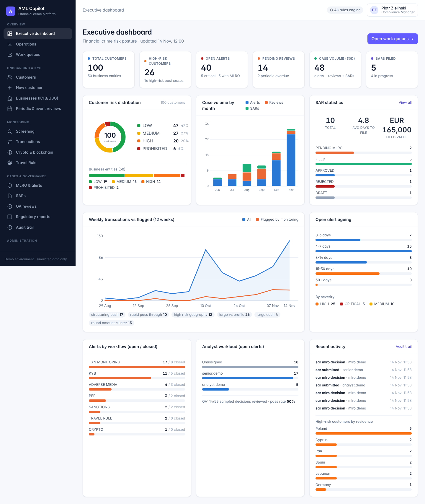

# AML Copilot

AI-assisted financial-crime compliance platform — a working, demo-ready prototype.
Onboarding (KYC/CDD/EDD), screening, source of funds/wealth, KYB/UBO, crypto & transaction monitoring,
MLRO escalation, SAR generation, QA and regulatory reporting — pre-loaded with realistic synthetic data.



## Run it (pick one)

| | Command | Open |
|---|---|---|
| **Docker, full stack** (Postgres + API + UI) | `./setup.sh`  *(or `docker compose up --build`)* | http://localhost:3000 |
| **Docker, single container** (what free hosts run) | `make single` | http://localhost:8080 |
| **No Docker** (Python 3.12 + Node 20) | `./setup.sh --local` | http://localhost:3000 |

First start seeds the demo data (~15 s). Then sign in with **any persona — password `demo1234`**.

> Want a public URL for teammates? See **[DEPLOY.md](DEPLOY.md)** — Render free tier (blueprint included) or a 30-second tunnel from your laptop.
> Running the demo for stakeholders? Follow **[DEMO_SCRIPT.md](DEMO_SCRIPT.md)**.

## Personas

| Persona | Login | What they can do |
|---|---|---|
| Analyst — Anna Kowalska | `analyst.demo` | Works queues, runs assessments, drafts SARs, escalates alerts |
| Senior Analyst — Stefan Nowak | `senior.demo` | + approves HIGH-risk customers, completes QA reviews |
| MLRO — Maria Wiśniewska | `mlro.demo` | Decides escalations, approves/files SARs, approves reports |
| Compliance Manager — Piotr Zieliński | `manager.demo` | Executive MI, QA, regulatory report approval |
| Admin — Alex Admin | `admin.demo` | Users & roles, demo-data reset |

Permissions are enforced by the API from the users table (not by the browser), and **four-eyes rules** apply:
a SAR preparer cannot approve their own SAR, a report's generator cannot approve it, a QA reviewer cannot review their own decision.

## What's in the box

* **Executive dashboard** — customers, high-risk, open alerts, pending reviews, case volume, SAR statistics, risk distribution, alert ageing, transaction trend, analyst workload.
* **Work queues** — KYC, CDD, EDD, SoF, SoW, sanctions / PEP / screening / transaction / KYB / crypto alerts, periodic & event-driven reviews, SAR escalation.
* **Customer case** — profile, agent pipeline (KYC→CDD→EDD→screening→SoF→SoW→risk), screening hits with dispositions, reviews, AI case note, decision with rationale.
* **KYB / UBO** — ownership graph, UBO resolution, shell-company and nominee indicators.
* **Crypto** — wallet screening, exposure tracing (mixers, darknet, sanctioned), Travel Rule checks, transaction analysis.
* **Transaction monitoring** — 6 rules: structuring, high-risk geography, large-vs-profile, rapid pass-through, large cash, round-amount clusters.
* **MLRO dashboard, SAR generator, QA review, regulatory reporting, immutable audit trail.**
* **Investigations & FIU (Phase 4)** — FIU dashboard (8 tiles), case queues (Alert → Triage → FIU → Escalation → SAR → MLRO), nine-step investigation workbook, and seven agents:
  RBI (timeline, hypotheses, confidence, priority), FIU (suspicion assessment, mule networks, intelligence package), AML Investigations (alert triage + case notes + disposition recommendation),
  Entity Link Analysis (shared phone/email/IP/device/wallet/bank account/address/directors/UBOs, hidden associations), Advanced Typology (10 typologies, transparent indicator points),
  Crypto Investigation (forward/backward tracing, cross-chain bridge pairing, mixer ID, clusters, path map; **simulated** Chainalysis/TRM/Elliptic/Crystal adapters),
  SAR agent (illustrative UK SAR→NCA, FINTRAC STR, MAS STR→STRO, FIU intelligence package). Terrorist-financing and sanctions findings always require MLRO judgement.
* **AML operating model** (`/operating-model`) — 26 lines (25 teams + SoF/SoW) in 3 tiers + 5 optional modules; live recalculation of % automatable, FTE capacity, and the activities that must stay human-led per FCA / FATF / MAS / FINTRAC / EBA. **All percentages are the author's estimates, not benchmarks.**
* **Admin** — user/role management, one-click **Reset demo data**.

### Demo dataset (deterministic)
100 customers · 50 businesses · 500 transactions · 60 alerts (sanctions, PEP, adverse media, transaction, KYB, crypto, Travel Rule) ·
10 SARs in every state · QA samples · ~1,500 audit rows spread over ~6 months. Includes undeclared PEPs, sanctioned matches,
name-collision false positives, prohibited-jurisdiction customers, shell-company chains and a sanctioned-wallet case.
FIU scenarios (full seed only): a 5-account mule ring, a 6-account smurfing ring, a trafficking trio, a terrorist-financing pattern, round-tripping and TBML corporates, the Kozlov–Baltic sanctioned network, a cross-chain bridge→mixer wallet, two benign household pairs, and 14 back-dated investigations across every queue.

## AI: what is real and what is simulated
* Every agent is a **deterministic rules engine** with an explainable score. Decisions are never delegated to an LLM.
* "AI" case summaries/narratives are **template-generated by default**. Set `ANTHROPIC_API_KEY` and Claude writes them (top-bar badge shows which mode is active).
* Sanctions/PEP lists, blockchain attribution and regulator submissions are **simulated** fixtures — see `backend/app/modules/`. Swap in a real list provider / chain-analytics API for production.

## Architecture

```
Browser ──► Next.js 14 (UI, one public port) ──/api/*──► FastAPI ──► Postgres (compose) | SQLite (single container)
                                                          └─ agents · modules · audit log · optional Claude layer
```
`backend/` FastAPI + SQLAlchemy 2 + pydantic v2 · `frontend/` Next.js (app router), Tailwind, hand-built SVG charts ·
`sql/` schema + reporting views · `docker/` single-container entrypoint · `docs/screenshots/`.

## Tests
`make test` — 65 backend tests (incl. FIU link analysis, typologies, case lifecycle and permissions, SAR formats, operating-model maths) (rules, permissions/four-eyes, dataset invariants, reset). Verified on SQLite and PostgreSQL 16. CI: `.github/workflows/ci.yml`.

## Configuration
See [`.env.example`](.env.example). **If you expose the app publicly, change `DEMO_PASSWORD` and `AUTH_SECRET`.** Demo auth is deliberately simple; it is not production authentication.

## Production hardening checklist (not done in this prototype)
SSO/OIDC + MFA · per-tenant data isolation · encrypted secrets & KMS · real list/chain providers · WORM audit storage ·
model-risk governance for the LLM layer · migrations (Alembic) · load/pen testing · regulator-specific SAR/goAML formats.

MIT licensed — see [LICENSE](LICENSE).
